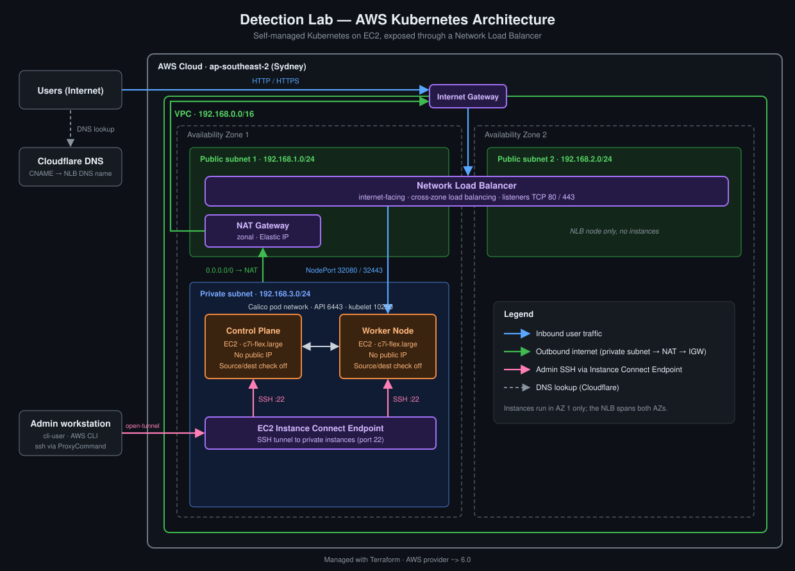

## Cloud Architecture

1. Create a VPC
2. Create two public subnet & one private subnet.
3. Attach a IGW to the VPC
4. Create a NAT gateway & attach it in to the public subnet.
	1. zonal
	2. public
	3. elastic ip
5. Create two RT. one public and one private.
	1. associate public rt to public subnet
		1. Create a route, `0.0.0.0/0` to the internet gateway
	2. associate private rt to private subnet
		1. Create a route, `0.0.0.0/0` to the nat
6. create a IAM user, `cli-user`.
	1. Attach the administrative access policy.
	2. Generate the security creds. Download that key if needed.
	3. Run `aws configure` on the cli.
	4. The ssh command to the ec2 instances will look like this `ssh -i "k8s-cloud-control_plane.pem" admin@i-00ce641a7ae26a529 -o ProxyCommand='aws ec2-instance-connect open-tunnel --instance-id %h'`. Can make it short in the ssh_config.
7. Create two ec2 instances and place them in the private subnet.
	1. Setup VPC endpoint for ec2 connect to the ec2.
	2. Disable source/destination checking on both instances.
8. Create three security groups. One for NLB, CP and WN.
9. Create 2 target groups for the NLB. Can only register the ec2 instance to the traget-group once the instance is running.
	1. One to take http traffic to port 32080
	2. Another one to take https traffic to port 32443
10. Install k8s in the ec2 instances
11. Create NLB
	1. Enable cross-zone load balancing on the NLB.

### Install

- It can be easily setup using terraform.
- Go to the terraform directory and run the following commands to set the lab-environment up.
- Change the key with your key in the `key` directory. Also update the changes in `endpoint.tf` file in the terraform directory.
```bash

terraform apply                  # To create all the resources
terraform destroy                # To delete all the resources

```

## Kubernetes Architecture

1. Disable Swap
2. Load Essential Kernel Modules
3. Configure critical sysctl parameters
4. Install container runtime, [Containerd](./setup/Containerd.md) is what is chose
5. Setting Up the Kubernetes Repositories
6. Install kubelet [kubeadm](./setup/Installing%20kubeadm.md) kubectl
7. Initialize the Cluster
8. Install [Calico](./setup/Calico.md) CNI
9. Join the Worker Node
10. Install [Helm](./setup/Helm.md)
11. Install [Metrics-server](./setup/Metrics-server.md)
12. Install [MetalLB](./setup/MetalLB.md),if installing locally.
13. Install [Envoy Gateway](./setup/Envoy%20Gateway.md) + apply the Corza proxy settings.
14. Install [Cert-Manager](./setup/Cert-Manager.md)
15. Setup [Splunk](./setup/Splunk.md) otel, if we want that. Its optional.
16. Verify Cluster Health
17. Test Pod Scheduling
18. Deploy the vulnerable web app ([Juice-shop](./setup/Juice-shop.md)). Its optional.

### Install

1. Using scripts to install is the easiest way to setup both nodes.
2. I would recommend reading and understanding the components involved in the installation process.
3. The steps involved with in the script is similar. But I have made some updates to the installation process compared to the manual way.

> The script doesn't install Splunk otel. I made it that way because I wanted the freedom to install it when I decide to play with Splunk.

> The script also doesn't deploy the OWASP Juice Shop. I have to apply it manually.

```bash
git clone -b cloud https://github.com/wwwcooldaki78-cyber/k8s-lab.git

cd k8s-lab

scripts/prepare.sh --cp                         # Run on control-plane
scripts/prepare.sh --wn                         # Run on worker-node

source /etc/bash.bashrc                         # Exec on both VMs
source ~/.bashrc                                # Exec on both VMs

scripts/init-cp.sh                              # Exec on control-plane

# Copy the "join" command. Create a file called 'worker-join-command.txt' in the worker-node and paste the command, then continue.

scripts/connect-wn.sh                           # Exec on worker-node

chmod 600 secrets/cloudflare-api-token          # Get the API-token and paste it                                                   in this file on "control-plane"

scripts/addons.sh                               # Exec on control-plane
```

1. I had used this script for one control-plane and one worker-node setup. Might have to modify the scripts little bit if you are planing to go with some other architecture type.
2. **Step 1:** run the [prepare.sh](./scripts/prepare.sh) on both nodes.
3. **Step 2:** run the [init-cp.sh](./scripts/init-cp.sh) on the control plane.
	- After the script has finished running, copy the contents of `worker-join-command.txt` form the data-plane.
	- Then create a new file called `worker-join-command.txt` in the worker node and paste the contents here.
4. **Step 3:** run the [connect-wn.sh](./scripts/connect-wn.sh).
5. **Step 4:** run the [addons.sh](./scripts/addons.sh)
6. **Step 5:** When you are ready deploy the vulnerable app by running the commands shown [below](#deploy-owasp-juice-shop).

#### Deploy Owasp Juice Shop

> Run these, if we want to play with owasp-juice-shop. Otherwise we can ignore this.

```bash

kubectl apply -f ./app/juice-shop.yaml           # Change the image ;)

# Uncomment the last line in the gateway.yaml based on where you are installing k8s. If you're cloud no change, if local VM, then uncomment the line

kubectl apply -f ./infra/gateway.yaml -f ./infra/httproute.yaml      

watch -n 1 kubectl get gateway -A

kubectl apply -f ./app/waf-policy.yaml

kubectl get envoyextensionpolicy -n juice-shop

```

## Splunk SIEM

> I for no specific reason, to make the setup easy, I decided to install splunk as kubernetes deployment pod.

1. Apply the `splunk.yaml`.
	```bash
	kubectl apply -f ./app/splunk.yaml
	```
2. Tunnel the traffic. We will be able to access the web-panel using `http://localhost:8000/`.
	```bash
	ssh -L 8000:localhost:30800 dl-wn
	```
3. Create a new `index` in the Splunk for our logs. Keep all the settings to default, just need to give it a name.
4. Install `Splunk Add-on for Amazon Web Services` app in the Splunk, its like an add-on.
5. Create a new input. `Inputs → Create New Input → CloudTrail → SQS-Based S3`
6. Give it a name `cloudtrail-sqs`. Unpick `Signature Validate All Events` box. Select the AWS Account, from the drop down menu. Select the region, this must match where our queue lives. **SQS queue name:** `cloudtrail-queue`. Finally, remove the default index and pick the index we created.

<table>
  <tr>
    <td valign="middle">
      
    </td>
    <td valign="middle">
      <h2>Attack Simulation</h2>
    </td>
  </tr>
</table>

> [!TIP]
> - In this lab, we can attack kubernetes, aws, or the owasp-juice-shop.
> - For Cloud Detection Engineering, look [here](./sigma_rules/README.md).
> - For web based attack, look [here](./web_attacks/README.md)

## Install on BareMetal

> Read the scripts and understand the architecture design I have decided to go with. It will be helpful.

- If you are planing to run this script in VM, we have two choices. 
	1. We can run the script as same as like we need to do in the cloud. Then we'll have to add a **loadbalancer**. I used a docker container of `HAproxy`.
	2. Otherwise we can make create a `type: Loadbalancer` service and use metalLB to act as `L2` and redirect traffic to this service.
- I created the docker container using the following command.
	```bash
	echo 'net.ipv4.ip_unprivileged_port_start=80' | sudo tee -a /etc/sysctl.conf
	sudo sysctl -p
	
	docker run -d --name nlb-sim -p 80:80 -p 443:443 -v ./infra/haproxy.cfg:/usr/local/etc/haproxy/haproxy.cfg:ro haproxy:2.9
	```

## License

This repository contains software and educational documentation released under different licenses.

- **Code and scripts:** MIT License
    
- **Documentation and educational notes:** [CC BY 4.0](https://creativecommons.org/licenses/by/4.0/)
    

Unless otherwise stated, original software code and scripts are released under the MIT License, while original documentation and educational notes are released under CC BY 4.0.

Third-party content remains subject to its respective license. These licenses apply only to material I have the right to license.